# Inventory Management System - Stockroom
A inventory management system for products, stock movements, suppliers, and reports.

## Overview
Stockroom is an inventory management system for teams that need to maintain a shared product catalog and monitor stock. Authenticated users can manage products, categories, suppliers, stock movements, and operational reports.

## Screenshots
### Dashboard

| Dashboard overview | Dashboard stock summary |
|---|---|
| [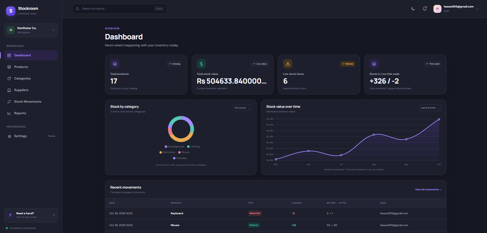](docs/screenshots/dashboard1.png) | [](docs/screenshots/dashboard%202.png) |

### Products

| Product catalog | Add product | Edit product |
|---|---|---|
| [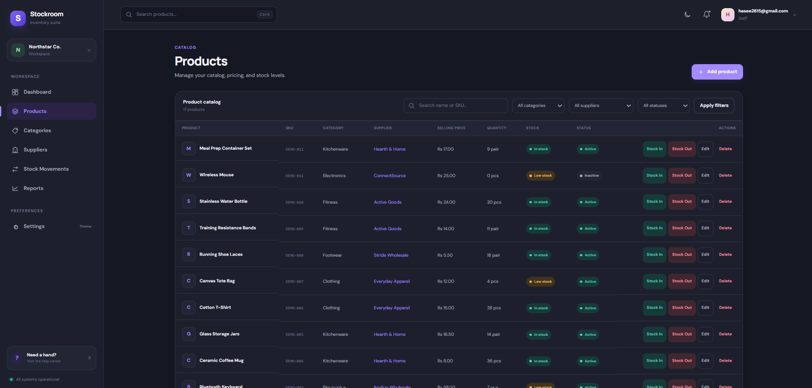](docs/screenshots/products.png) | [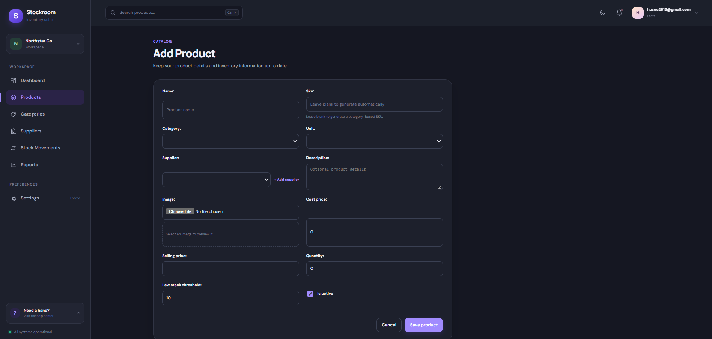](docs/screenshots/addproduct.png) | [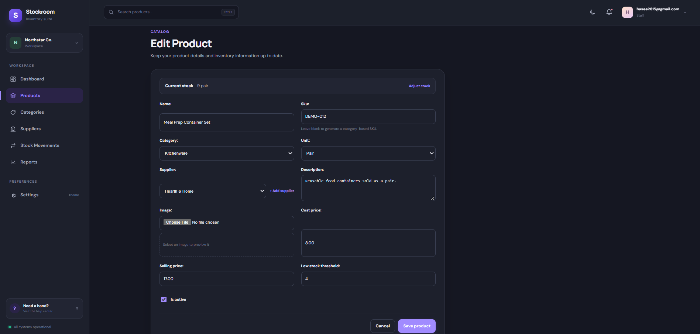](docs/screenshots/editproduct.png) |

### Categories

| Category list | Add category | Edit category |
|---|---|---|
| [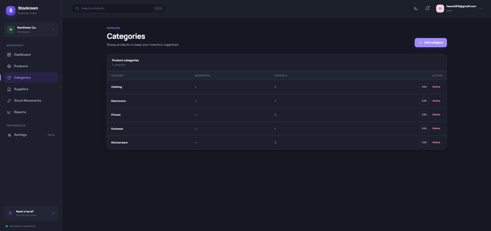](docs/screenshots/categories.png) | [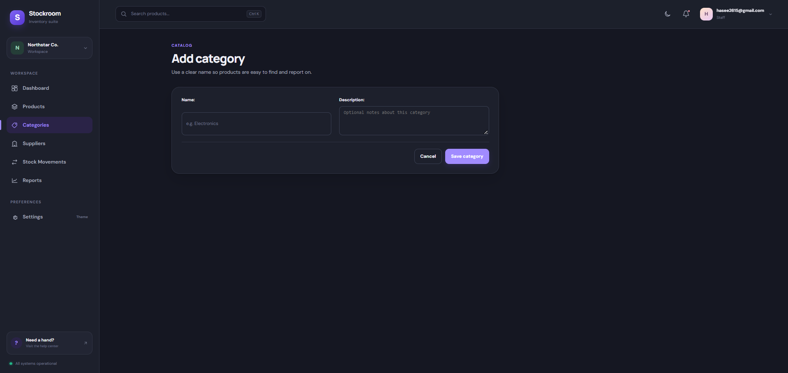](docs/screenshots/addcategory.png) | [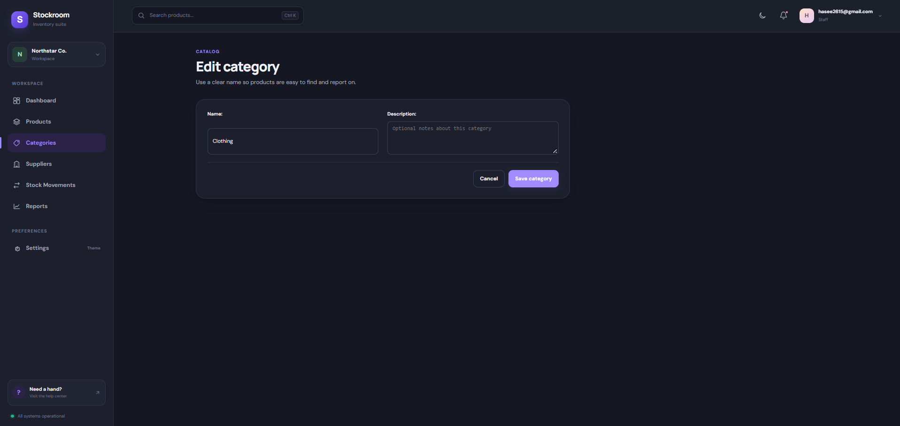](docs/screenshots/editcategory.png) |

### Stock movements

| Movement history | Stock in | Stock out | Adjust stock |
|---|---|---|---|
| [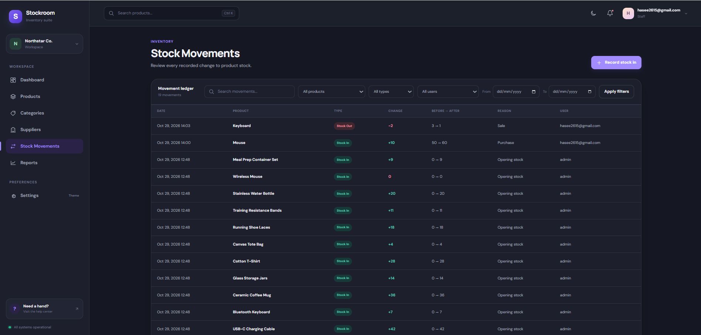](docs/screenshots/stockmovements.png) | [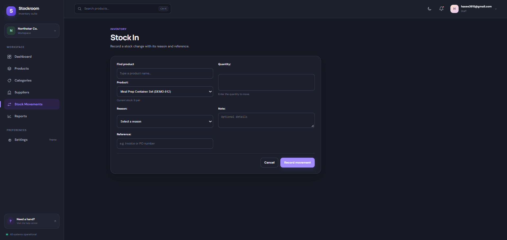](docs/screenshots/stockin.png) | [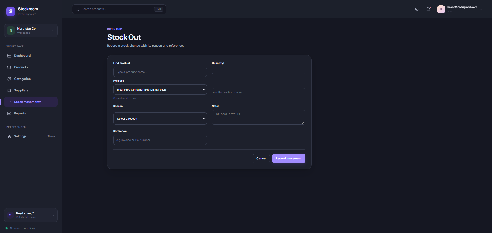](docs/screenshots/stockout.png) | [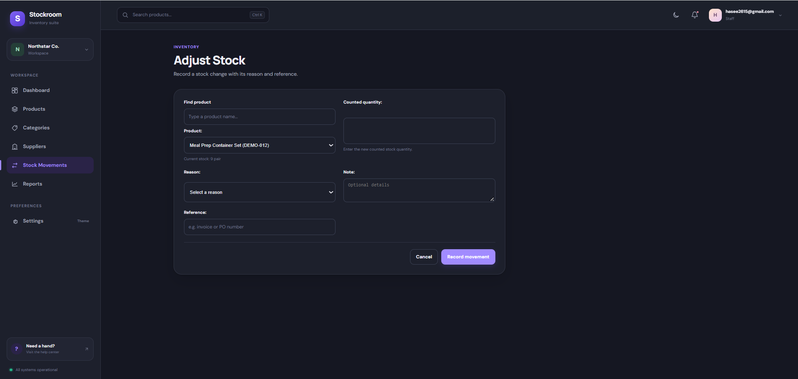](docs/screenshots/adjuststock.png) |

### Suppliers

| Supplier list | Add supplier | Edit supplier | Supplier details |
|---|---|---|---|
| [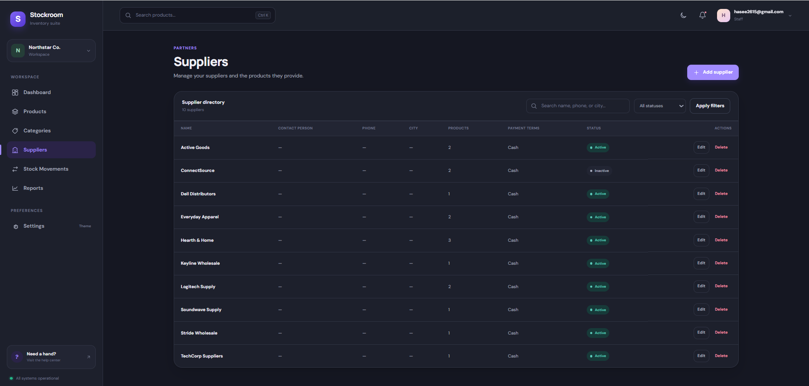](docs/screenshots/suppliers.png) | [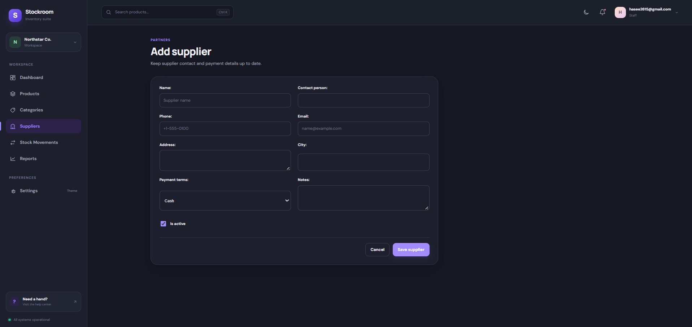](docs/screenshots/addsupplier.png) | [](docs/screenshots/editsupplier.png) | [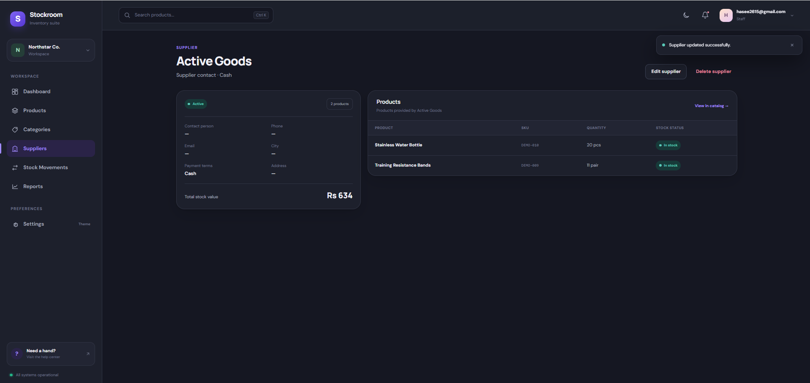](docs/screenshots/supplierdetail.png) |

### Reports

| Reports overview | Low-stock report | Stock movement report | Stock valuation |
|---|---|---|---|
| [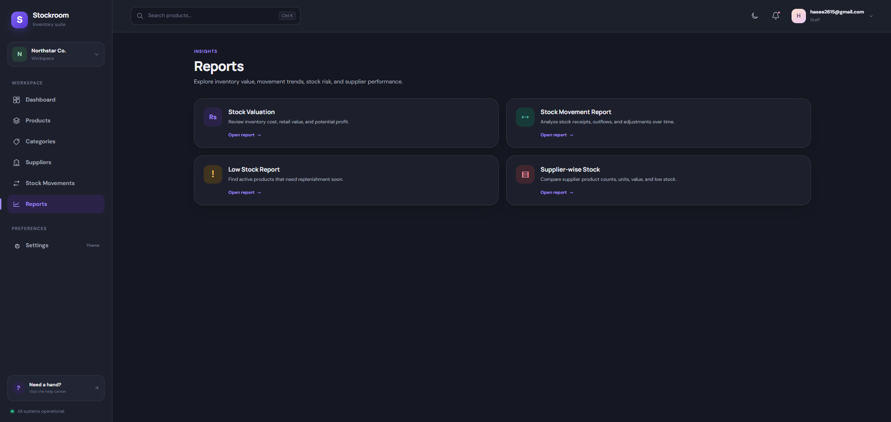](docs/screenshots/reports.png) | [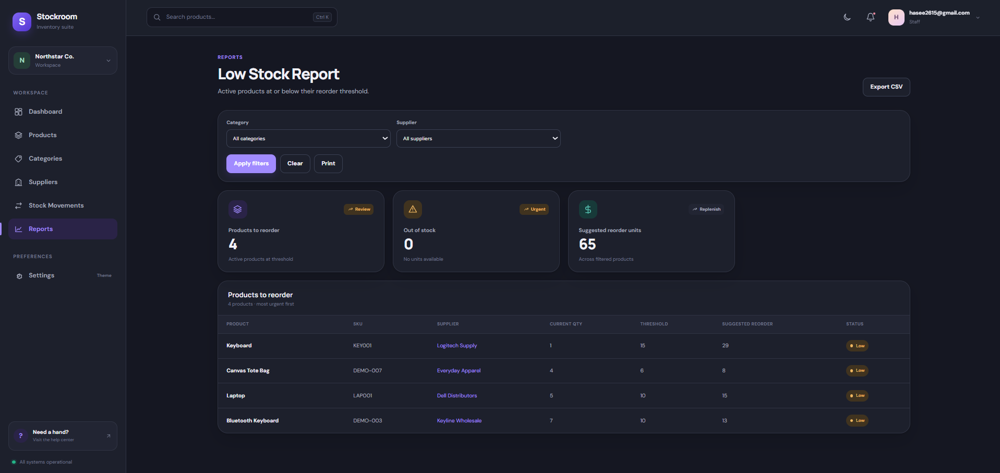](docs/screenshots/lowstockreport.png) | [](docs/screenshots/stock%20movementreport.png) | [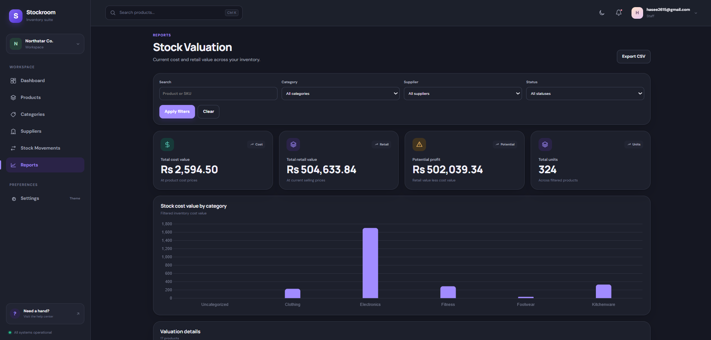](docs/screenshots/stockvaluation.png) |

| Supplier stock report |
|---|
| [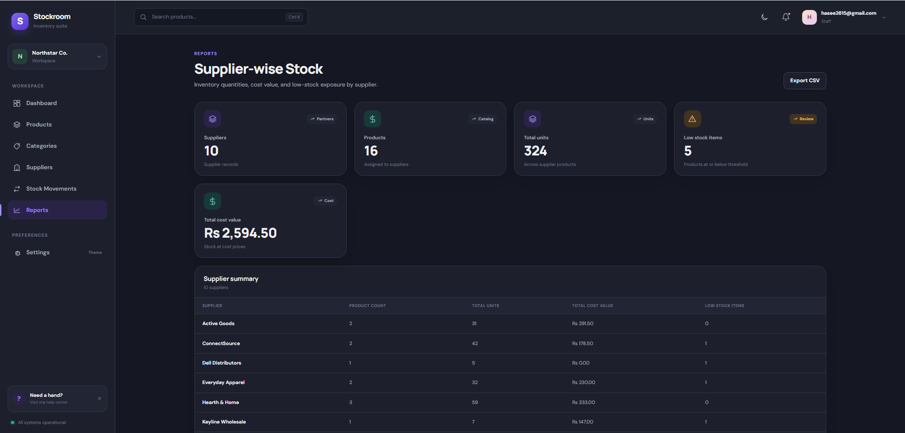](docs/screenshots/supplierwisestock.png) |

### Accounts

| Sign in | Sign up |
|---|---|
| [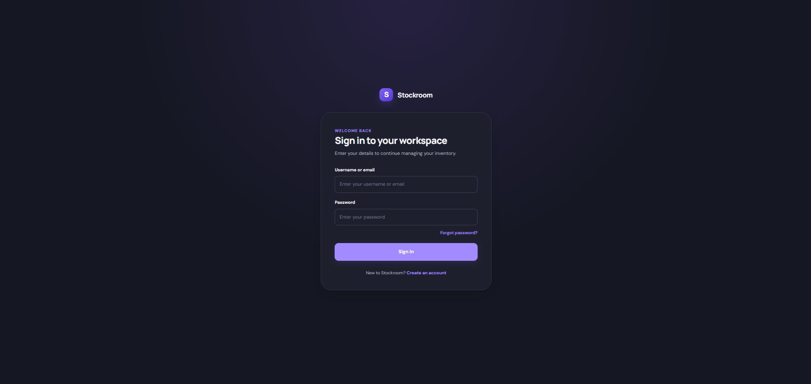](docs/screenshots/signin.png) | [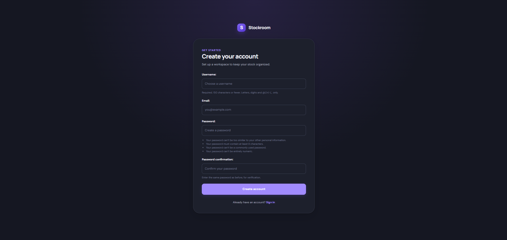](docs/screenshots/signup.png) |


## Features
### Dashboard
The dashboard summarizes catalog totals, stock value, low-stock alerts, recent movements, and supplier metrics.

### Products
Users can create, edit, view, search, filter, and deactivate products with category, unit, supplier, pricing, and image details.

### Categories
Users can create, edit, and remove product categories.

### Stock Movements
Users can record stock in, stock out, and quantity adjustments with immutable movement history.

### Suppliers
Users can manage supplier details and review supplier-associated products and stock.

### Reports
Users can filter stock, movement, low-stock, and supplier reports, view charts, and export CSV files.

### Accounts
Users can sign up, sign in, sign out, and request password-reset emails.

### Interface
The application uses a responsive custom interface with theme-aware charts.

## Tech Stack
- Python 3.14.2 (development environment; Django 6.0 supports Python 3.12+)
- Django 6.0.6 and SQLite
- Pillow 12.3.0 for product images
- python-decouple 3.8 for environment configuration
- Custom CSS and JavaScript with Chart.js 4.4.8 loaded from jsDelivr

## Architecture
Requests flow from Django URL routing to app views, through inventory or report services where needed, into Django ORM models, and finally to templates. Inventory data is shared between authenticated users rather than owned by individual accounts.

```text
manage.py
inventoryproject/          Settings and project URL, ASGI, and WSGI entry points
inventory/                 Catalog, accounts, stock models, forms, views, and services
  management/commands/     seed_sample_products management command
  migrations/              Inventory schema migrations
  templates/inventory/     Inventory and account pages
  static/inventory/        Custom CSS and JavaScript
reports/                   Report URLs, views, services, templates, and template tags
docs/screenshots/          Application screenshots
requirements.txt           Pinned Python dependencies
```

## Entity Relationships
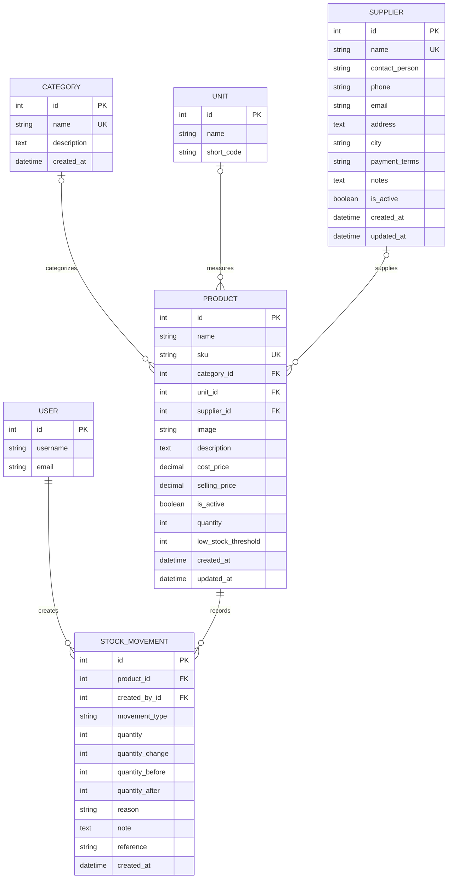

## Installation
Use PowerShell on Windows:

```powershell
git clone https://github.com/hasnainkhan2004/Inventory-Management-System.git
cd Inventory-Management-System
python -m venv .venv
.\.venv\Scripts\Activate.ps1
```

If PowerShell script activation is disabled, activate with:

```powershell
Set-ExecutionPolicy -Scope Process -ExecutionPolicy Bypass
.\.venv\Scripts\Activate.ps1
```

Then install dependencies, copy the local environment template, create the database schema and administrator account, and start the development server:

```powershell
pip install -r requirements.txt
Copy-Item .env.example .env
python manage.py migrate
python manage.py createsuperuser
python manage.py runserver
```

## Demo Data
A new user can sign up and log in, add categories and suppliers, create products, record stock in or out, and review reports.

The `seed_sample_products` management command is included, and inventory records are shared across authenticated users rather than scoped to an account.

Copyright (c) 2026 Hasnain Raza Khan. All Rights Reserved. See the LICENSE file.
